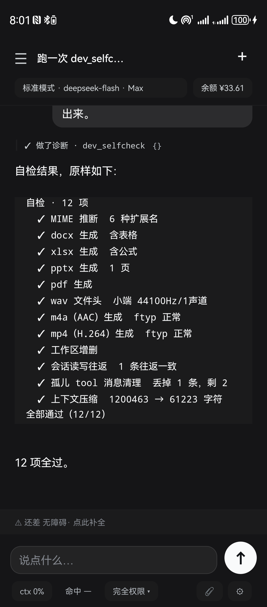
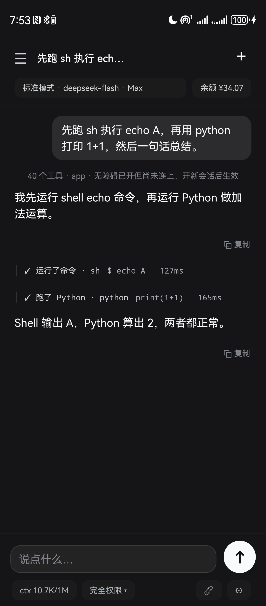
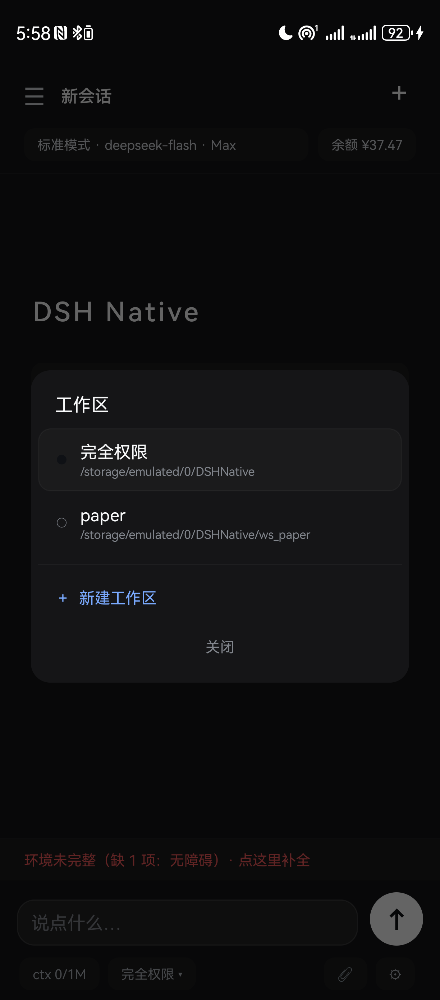

# DSH Native

[](https://github.com/YSCTG/dsh-native/releases/latest)


**[English](#english) · [中文](#中文)**

<p align="center">
  
  
  
</p>

---

## English

**An agent that runs on your phone — not a chat box.**

A DeepSeek agent harness written from scratch in Java for Android. One API key, no root,
no PC, no bundled Linux. 76 MB and 330 ms to a working screen.

It reads what is on the screen and taps for you, runs shell commands and Python, drives a
real browser, writes Office documents and media files, and can fan work out to a team of
sub-agents.

### What it actually does

| Capability | How |
|---|---|
| Read any app's UI | Accessibility service — `ui_dump` returns nodes with text and bounds |
| Tap, swipe, type into other apps | Accessibility gestures — `ui_tap` |
| See the screen | MediaProjection capture, sent to the model as a real image |
| Reach any file | Legacy storage access; the workspace is the phone, not a sandbox folder |
| Shell | Bundled Termux aarch64 binaries: `git`, `gh`, `curl`, `jq`, `node`, `less` |
| Python | Bundled CPython 3.14 with the standard library, no network needed |
| Web | Five browser tools driving a real WebView: open, read text, run JS, click, type |
| Office | `docx`, `xlsx`, `pptx`, `pdf` generated locally by hand-written OOXML and `PdfDocument` |
| Media | `wav`, `m4a` (AAC), `mp4` (H.264) through the platform's hardware codecs — no ffmpeg |
| Parallel work | `subagent`, `loop`, and a team with a shared, revision-locked task board |
| Skills | 29 built-in procedures, loaded on demand |
| Plugins | `.dshp` packages that add tools without a rebuild |
| MCP | Model Context Protocol servers over HTTP |
| Schedules | Recurring tasks in a foreground service |
| Workspaces | Any folder on the phone, each with its own conversation history |

42 tools in total. The tool list is frozen per session on purpose: toggling a plugin affects
new sessions only, so a running task never loses a tool mid-flight.

### Why not just bundle a Linux runtime

The obvious shortcut is to ship Ubuntu in a compatibility layer, run Node, and execute the
desktop agent unchanged. That buys full ecosystem compatibility — and costs about a
gigabyte, a syscall translation layer, and three build toolchains.

This project takes the other road: rewrite the loop natively.

| | Runtime-in-a-box | DSH Native |
|---|---|---|
| Install size | APK + ~1 GB runtime | **76 MB total** |
| Cold start | must boot a Linux environment | **321–424 ms** (measured) |
| Idle memory | not published | **74 MB PSS** (measured) |
| Tool overhead | every call crosses the compatibility layer | direct `fork/exec` of a native binary |
| Build | Flutter + Node + JDK + SDK/NDK on Linux | `aapt2 + javac + d8 + apksigner` |
| License | AGPL-3.0 | **MIT** |
| Ecosystem reach | runs anything you can `apt install` | fixed set of 42 tools |

Both are legitimate. The trade is breadth for weight, and this project chose weight.

### Measured, not claimed

Run on a HUAWEI ADA-AL10U (Android 12, arm64), release 14.1:

| Metric | Value |
|---|---|
| Cold start (`am start -W`) | **321 / 330 / 424 ms** |
| PSS at idle | **74 MB** |
| APK size | **76 MB**, of which 65 MB is the bundled toolchain |
| On-device self check | **12/12 in 225 ms** |
| Context compaction | `1,200,463 → 61,223 characters` |

`dev_selfcheck` is a tool, not a script you run on a PC. It generates a docx / xlsx / pptx /
pdf / wav / m4a / mp4 into the cache and validates each one's real structure — zip entries
present and non-empty, the xlsx actually carries its formula, a `%PDF` header, a WAV header
read as little-endian, `ftyp` at byte 4 for m4a and mp4. It also round-trips a session
through disk, pushes an orphan `tool` message through the repair path, and compacts a
1.2-million-character history.

### Behaviour worth knowing

**It talks between tool calls.** One short line before each step; the conclusion at the end
is not restated.

**You can steer it while it runs.** Type into the box and the send button becomes `↪`; the
message is injected at the next safe point (after the current tool returns, before the next
model call) instead of interrupting the work.

**Three guards, each for a different failure.** The same tool and arguments four times in a
row, five identical tool results in a row, or $0.15 spent in one turn — each stops the run
and says why. A hard cap of 80 model round-trips sits behind them.

**Interrupted turns resume themselves.** If the process dies mid-task, the next launch
notices the dangling tool call, patches a placeholder result, and continues without a tap.

**The context compacts itself.** Past 65% of the model's window, long tool outputs are
truncated first, then the oldest turns are dropped, keeping the system prompt, the first
user message and the most recent exchanges.

### Install

Grab the APK from [**Releases**](https://github.com/YSCTG/dsh-native/releases/latest), install
it, paste a DeepSeek API key. The setup screen walks through five permissions and shows what
each one unlocks.

> Android 8.0+ (API 26), arm64-v8a. No root, no PC, no companion app.

Inside the app, the drawer has "check for updates": it reads the GitHub Releases API, shows
the notes, downloads the APK through a mirror if `github.com` is unreachable, and hands it to
the system installer.

### Build

No Gradle, no AndroidX. The APK is assembled by hand:

```
aapt2 compile -> aapt2 link -> javac -> d8 -> zipalign -> apksigner
```

```powershell
. .\tools\env.ps1      # points at your JDK and Android SDK build-tools
.\build-apk.ps1        # produces DSHNative.apk
```

Three external pieces, two of them in the repo:

| File | Size | Purpose |
|---|---|---|
| `android/assets/tools.zip` | 65 MB | Termux aarch64 binaries: git, gh, curl, jq, node, less |
| `android/assets/py_stdlib.zip` | 4.8 MB | CPython 3.14 standard library *(in repo)* |
| `android/native/arm64-v8a/libpython3.14.so` | 5.7 MB | CPython interpreter *(in repo)* |

`tools.zip` has to be assembled from Termux packages into `bin/`, `lib/`, `libexec/`,
`share/`, `etc/`. Without it the app still runs — the terminal simply has no git or node.

The interpreter ships as `lib*.so` on purpose: from `targetSdk 29` upward Android refuses to
`execve` anything inside the app data directory. `nativeLibraryDir` is the only private path
that is still executable.

### Architecture

```
android/src/com/dshnative/
  Agent.java           tool table, agent loop, guards, steering, compaction
  DeepSeekClient.java  SSE streaming, reasoning effort, usage accounting
  MainActivity.java    transcript: interleaved text, tool chips, file cards
  Browser.java         WebView automation: open, text, js, click, type, enter
  BrowserActivity.java bottom-sheet browser panel
  UiAgentService.java  accessibility service: node dump, gesture dispatch
  Screen.java          MediaProjection frame capture
  Shell.java           subprocess runner with timeout and kill support
  Python.java          CPython bridge with a per-invocation environment
  Office.java          docx / xlsx / pptx / pdf writers (no third-party libraries)
  Media.java           wav / m4a / mp4 through MediaCodec and MediaMuxer
  FileProviderX.java   minimal ContentProvider so other apps can open our files
  Updater.java         GitHub releases, mirror fallback, installer handoff
  Team.java            sub-agents, inbox delivery, interruption
  TeamBoard.java       shared task board with revision locking
  Plugin.java          .dshp loader
  Mcp.java             Model Context Protocol client
  Policy.java          capability tiers, decisions, hash-chained audit log
  History.java         orphan-tool repair, context compaction
  SelfCheck.java       12 on-device assertions
  Session.java         append-only jsonl transcripts plus index
```

### Known limitations

- **No `pip`, no `ffmpeg`, no `apt`.** The bundled CPython is standard library only, and the
  toolchain is a fixed set. If you need arbitrary Linux packages, the runtime-in-a-box
  approach is the right one.
- **WebView cannot use a per-app proxy.** Android exposes no public API for it.
- **Screen capture needs consent per process.** Android 10+ has no persistent grant.
- **`uiautomator dump` from inside an app is blocked on some OEM ROMs** (Huawei among them),
  so UI reading goes through the accessibility service.
- **The accessibility toggle may need a physical gesture** on EMUI ("hold volume up and down
  for two seconds"). No app can bypass that; it is a system anti-fraud gate.
- **Early software.** There are no users yet, no telemetry, and no test suite beyond the
  on-device self check. Treat it accordingly.

### License

MIT — see [LICENSE](LICENSE). Use it, fork it, ship it, sell it.

---

## 中文

**一个跑在手机上的 agent，不是一个聊天窗口。**

用 Java 从零为 Android 重写的 DeepSeek agent harness。一个 API key，不需要 root，
不需要电脑，不在手机里塞 Linux。76 MB，330 毫秒就能开始干活。

它能读屏幕、替你点、跑 shell 和 Python、开一个真正的浏览器、生成本地 Office 与媒体文件，
还能把活派给一队子智能体。

### 它到底能做什么

| 能力 | 实现方式 |
|---|---|
| 读任意 App 的界面 | 无障碍服务 —— `ui_dump` 返回带文字和坐标的节点 |
| 点按、滑动、输入 | 无障碍手势 —— `ui_tap` |
| 看见屏幕 | MediaProjection 截图，作为图片交给模型 |
| 访问任意文件 | 传统存储权限；工作区就是整台手机，不是一个沙盒目录 |
| Shell | 内置 Termux aarch64 二进制：`git`、`gh`、`curl`、`jq`、`node`、`less` |
| Python | 内置 CPython 3.14 标准库，不联网也能跑 |
| 浏览器 | 五个工具驱动真实 WebView：打开、读正文、执行 JS、点击、输入 |
| Office | `docx`、`xlsx`、`pptx`、`pdf`，手写 OOXML + `PdfDocument` 本地生成 |
| 媒体 | `wav`、`m4a`(AAC)、`mp4`(H.264)，走平台硬件编码器，不用 ffmpeg |
| 并行 | `subagent`、`loop`，以及共享任务板的团队 |
| 技能 | 内置 29 个流程，按需加载 |
| 插件 | `.dshp` 包，加工具不用重新编译 |
| MCP | HTTP 传输的 Model Context Protocol 客户端 |
| 定时 | 前台服务里的周期任务 |
| 工作区 | 手机上任意目录，各自独立的对话历史 |

一共 42 个工具。工具表按会话冻结：开关插件只影响新会话，跑着的任务不会中途丢工具。

### 为什么不干脆塞一个 Linux 运行时

最省事的路是塞一个兼容层里的 Ubuntu，跑 Node，把桌面版原样搬上去。这样能继承整个生态，
代价是约 1 GB、一层系统调用翻译、三条构建链。

这个项目走了另一条：把循环原生重写。

| | 塞运行时 | DSH Native |
|---|---|---|
| 安装体积 | APK + 约 1 GB | **共 76 MB** |
| 冷启动 | 要先拉起 Linux 环境 | **321–424 ms**（实测） |
| 空闲内存 | 未公开 | **74 MB PSS**（实测） |
| 工具开销 | 每次调用穿过兼容层 | 直接 `fork/exec` 原生二进制 |
| 构建 | Flutter + Node + JDK + SDK/NDK | `aapt2 + javac + d8 + apksigner` |
| 许可 | AGPL-3.0 | **MIT** |
| 生态广度 | `apt install` 能装的都能用 | 固定 42 个工具 |

两条路都成立。这笔交易是"用广度换重量"，这个项目选了重量。

### 数字，不是说法

在 HUAWEI ADA-AL10U（Android 12，arm64）上测得，版本 14.1：

| 指标 | 数值 |
|---|---|
| 冷启动（`am start -W`） | **321 / 330 / 424 ms** |
| 空闲 PSS | **74 MB** |
| APK | **76 MB**（其中 65 MB 是内置工具链） |
| 端上自检 | **12/12，225 ms** |
| 上下文压缩 | `1,200,463 → 61,223 字符` |

`dev_selfcheck` 是个工具，不是电脑上跑的脚本。它会真的生成 docx / xlsx / pptx / pdf /
wav / m4a / mp4，然后校验结构：zip 条目存在且非空、xlsx 里确实写了公式、PDF 头是 `%PDF`、
WAV 头按小端读出 44100、m4a 和 mp4 第 4 字节是 `ftyp`。另外还跑一遍会话写读往返、
把一条孤儿 `tool` 消息喂进修复路径、以及把一百二十万字符的历史压一遍。

### 几个值得知道的行为

**工具之间会说话。** 每一步之前给一行说明，结尾直接给结论，不复述过程。

**跑着的时候可以插话。** 在输入框打字，发送键会变成 `↪`，消息在下一个安全点注入
（当前工具返回之后、下一次模型请求之前），不打断正在做的事。

**三道闸，各管一种病。** 同一工具同一参数连续四次、工具结果连续五次完全相同、
单轮花掉 $0.15 —— 任意一条触发都会停下并说明原因。最后还有 80 轮往返的硬上限。

**被打断的回合会自己接上。** 进程中途死掉，下次启动会发现悬空的工具调用，补一条占位结果，
然后继续，不用你点任何东西。

**上下文会自己压缩。** 超过模型窗口 65% 时，先截断超长工具输出，再丢最老的回合，
保留 system、第一条用户消息和最近的若干条。

### 安装

从 [**Releases**](https://github.com/YSCTG/dsh-native/releases/latest) 下载 APK，装上，
填一个 DeepSeek API key。设置页会带你过五个权限，并说明每个开了能干什么。

> Android 8.0+（API 26），arm64-v8a。不需要 root，不需要电脑，没有配套软件。

应用内抽屉里有「检查更新」：读 GitHub Releases、显示更新说明、`github.com` 不通时自动
换镜像下载，然后交给系统安装器。

### 构建

没有 Gradle，没有 AndroidX。APK 是手拼的：

```
aapt2 compile -> aapt2 link -> javac -> d8 -> zipalign -> apksigner
```

```powershell
. .\tools\env.ps1      # 指向你的 JDK 和 Android SDK build-tools
.\build-apk.ps1        # 产出 DSHNative.apk
```

三个外部件，其中两个在仓库里：

| 文件 | 大小 | 用途 |
|---|---|---|
| `android/assets/tools.zip` | 65 MB | Termux aarch64 二进制：git、gh、curl、jq、node、less |
| `android/assets/py_stdlib.zip` | 4.8 MB | CPython 3.14 标准库（**在仓库里**） |
| `android/native/arm64-v8a/libpython3.14.so` | 5.7 MB | CPython 解释器（**在仓库里**） |

`tools.zip` 需要自己从 Termux 包组装到 `bin/`、`lib/`、`libexec/`、`share/`、`etc/`。
缺了它 App 照样能跑，只是终端里没有 git 和 node。

解释器之所以是 `lib*.so`：从 `targetSdk 29` 起，Android 不允许 `execve` App 数据目录里的
任何东西。`nativeLibraryDir` 是唯一还允许执行的私有路径。

### 已知限制

- **没有 `pip`、没有 `ffmpeg`、没有 `apt`。** 内置的 CPython 只有标准库，工具链是固定集合。
  需要任意 Linux 包的话，"塞运行时"那条路才是对的。
- **WebView 不能单独设代理。** Android 没有公开 API。
- **截屏每个进程都要授权一次。** Android 10+ 没有持久授权。
- **部分 OEM 屏蔽 App 内的 `uiautomator dump`**（华为就是），所以读界面走无障碍服务。
- **无障碍开关可能要实体按键确认**：EMUI 要求"按住音量上+下 2 秒"。没有任何 App 能绕过，
  那是系统防诈骗闸门。
- **早期软件。** 目前没有用户、没有埋点，除了端上自检也没有测试套件。请按这个前提使用。

### 许可

MIT —— 见 [LICENSE](LICENSE)。用、改、发布、卖都行。
