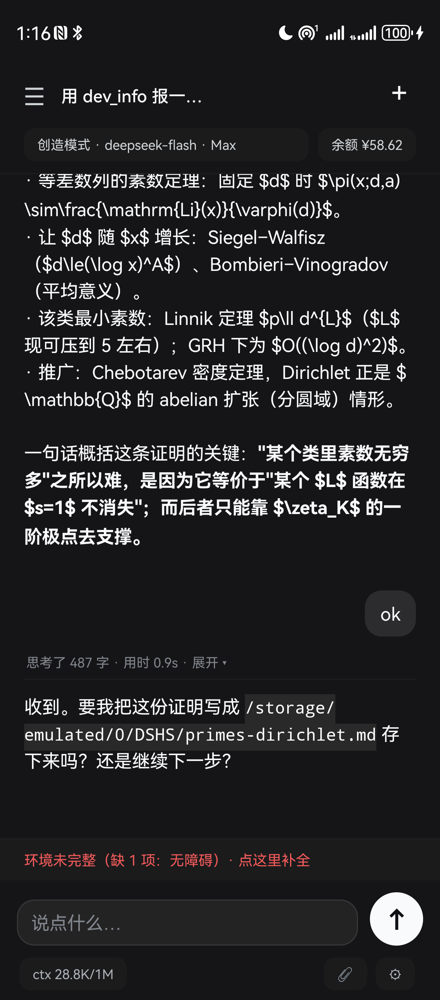
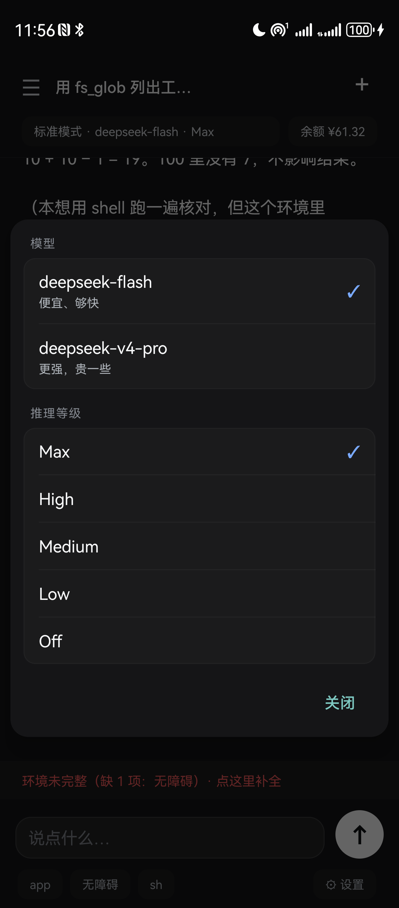

# DSH Native

**An agent that runs on your Android phone — not a chat app.**

DeepSeek Harness, reimplemented natively for Android. One API key, no root, no PC.
It reads your screen and taps for you, writes files, runs shell commands and Python,
browses the web in a built-in browser, and can fan work out to a team of sub-agents.

<p align="center">
  
  
</p>

---

## What makes it an agent

Most "AI on Android" apps are a text box in front of an API. This one has hands.

| Capability | How |
|---|---|
| Read the UI of any app | Accessibility service — `ui_dump` returns nodes with text and bounds |
| Tap, swipe, type into other apps | Accessibility gestures — `ui_tap` |
| See the screen | MediaProjection capture, sent to the model as a real image |
| Reach any file | Scoped storage plus `MANAGE_EXTERNAL_STORAGE`; the workspace is the whole phone |
| Shell | Bundled Termux aarch64 binaries: `git`, `gh`, `curl`, `jq`, `node`, `less` |
| Python | Bundled CPython 3.14 with the standard library, runs offline |
| Web | Five browser tools driving a real WebView: open, read, run JS, click, type |
| Parallel work | `subagent`, `loop`, and a team: spawn, list, collect, send, wait, stop |
| Shared task board | Revision-locked tasks in `.dshnative/board.json`, visible to every agent |
| Skills | 29 reusable procedures (TDD, review loop, plan loop, blast radius, ...) |
| Plugins | `.dshp` packages with your own tools, loaded without a rebuild |
| MCP | Model Context Protocol servers with auto-discovery |
| Schedules | Recurring tasks that survive screen-off, run in a foreground service |

Forty tools at full capability. The tool list is frozen per session on purpose:
toggling a plugin affects new sessions only, so a running task never loses a tool mid-flight.

## Design decisions worth knowing

**Streaming that mirrors the real order of events.** Text, tool call, text, tool call — each
segment is its own block, so you see what the model did in the order it did it. Reasoning
collapses to one line (`Analyzed · 312 chars · 4.1 s`); the raw chain of thought is not stored.

**Long-running work is bounded but generous.** Shell defaults to 120 s and takes up to 600 s
on request; Python up to 600 s. An 11-minute watchdog is the last resort — always later than
any tool's own timeout. The stop button kills the child process instead of waiting it out.

**Interrupted turns resume themselves.** If the process dies mid-task (app update, OOM,
crash), the next launch spots the dangling tool call, patches a placeholder result, and
continues without a tap. A guard stops a crash loop from retrying forever.

**Three-tier permissions, fail-closed.** Every capability maps to a tier — `APP`, `A11Y`,
`ROOT` — and a decision: auto, confirm, deny. When the tier is unavailable the tool is not
registered at all rather than silently degraded. Every call lands in a hash-chained audit log.

**The API key is encrypted at rest** with AES-256-GCM and a key held in AndroidKeyStore.
If the keystore is unavailable the app falls back to plaintext *and says so in the UI*.

## Requirements

- Android 8.0+ (API 26), arm64-v8a
- No root
- A DeepSeek API key

Granted in-app: accessibility service, all-files access, battery-optimisation exemption,
notifications, screen capture. Each is optional; without accessibility the agent loses UI
control but keeps files, shell, Python and the browser.

## Install

Download `DSHNative.apk` from [Releases](../../releases), install, paste your API key.
The setup screen walks through the five permissions and shows what each one unlocks.

## Build

No Gradle, no AndroidX. The APK is assembled by hand:

```
aapt2 compile -> aapt2 link -> javac -> d8 -> zipalign -> apksigner
```

```powershell
. .\tools\env.ps1      # points at your JDK and Android SDK build-tools
.\build-apk.ps1        # produces DSHNative.apk
```

Three external pieces are **not in this repository** because of size:

| File | Size | Purpose |
|---|---|---|
| `android/assets/tools.zip` | 65 MB | Termux aarch64 binaries: git, gh, curl, jq, node, less |
| `android/assets/py_stdlib.zip` | 4.8 MB | CPython 3.14 standard library *(in repo)* |
| `android/native/arm64-v8a/libpython3.14.so` | 5.7 MB | CPython interpreter *(in repo)* |

`tools.zip` has to be assembled from Termux packages into `bin/`, `lib/`, `libexec/`,
`share/`, `etc/`. Without it the app still runs — the terminal just has no git, curl or node.

The interpreter ships as `lib*.so` on purpose: from `targetSdk 29` upward Android refuses to
`execve` anything inside the app data directory. `nativeLibraryDir` is the only private path
that is still executable, so the binaries live there and are invoked from it.


### Office files

`office_write` generates **docx, xlsx, pptx and pdf** locally — no cloud, no LibreOffice:

```
office_write(format="xlsx", path="out/report.xlsx",
             spec={"sheets":[{"name":"Q2","header":true,
                              "rows":[["月份","收入"],["4月",137900]]}]})
```

docx and pptx are OOXML assembled by hand (`zipfile` territory, no `lxml`, which cannot be
built for Android); xlsx uses inline strings and a minimal style sheet. PDF goes through
`android.graphics.pdf.PdfDocument` instead, so Chinese text, bold and wrapping come from the
system font stack for free.

Verified against `python-docx`, `openpyxl`, `python-pptx` and `pypdf` — all four round-trip.
## Architecture

```
android/src/com/dshnative/
  Agent.java           tool table, agent loop, streaming, watchdog, cancellation
  DeepSeekClient.java  SSE streaming, reasoning effort, usage accounting
  MainActivity.java    transcript: interleaved text, tool chips, file cards, resume
  BrowserActivity.java bottom-sheet browser panel with URL bar, reload, close
  Browser.java         WebView automation: open, text, js, click, type, enter
  UiAgentService.java  accessibility service: node dump, gesture dispatch
  Screen.java          MediaProjection frame capture
  Shell.java           subprocess runner with timeout and kill support
  Python.java          CPython bridge with a per-invocation environment
  Tools.java           bundled toolchain extraction and PATH assembly
  Team.java            parallel sub-agents, inbox delivery, interruption
  TeamBoard.java       shared task board with revision locking and dependencies
  Plugin.java          .dshp loader (http, file and app tool implementations)
  Mcp.java             Model Context Protocol client
  Policy.java          capability tiers, decisions, hash-chained audit log
  Session.java         append-only jsonl transcripts plus index
  Schedule.java        recurring tasks
```

## Known limitations

- **WebView cannot use a per-app proxy.** Android exposes no public API for it, so the
  built-in browser always goes direct even when the shell has `http_proxy` set.
- **Screen capture needs consent per process.** MediaProjection shows a system dialog each
  time the app starts; Android 10+ has no persistent grant.
- **`uiautomator dump` from inside an app is blocked on some OEM ROMs** (Huawei among them),
  so UI reading goes through the accessibility service.
- **The accessibility toggle may need a physical gesture** on EMUI ("hold volume up and down
  for two seconds"). No app can bypass that; it is a system anti-fraud gate.

## License

MIT — see [LICENSE](LICENSE). Use it, fork it, ship it, sell it.